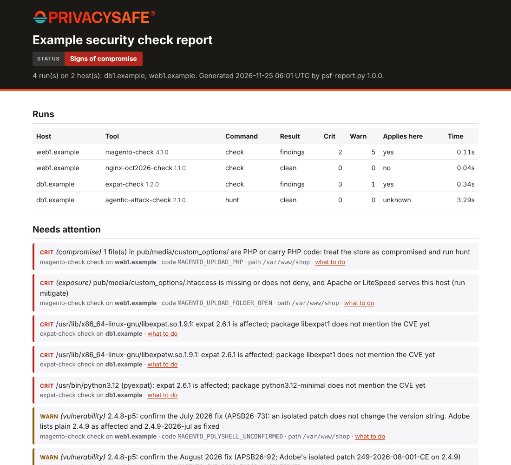
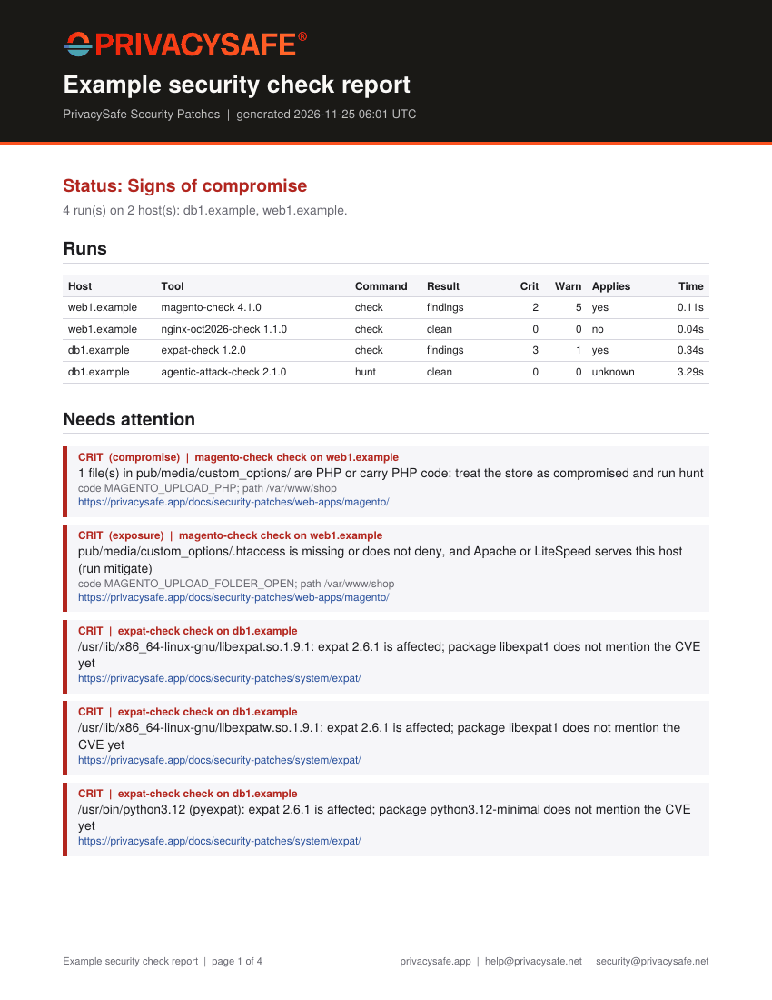
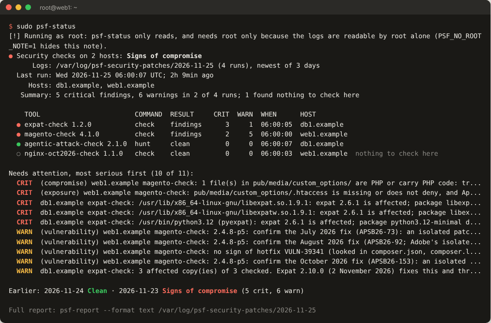
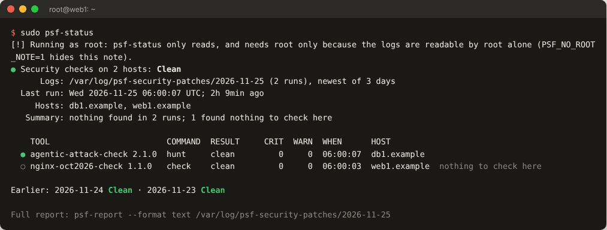
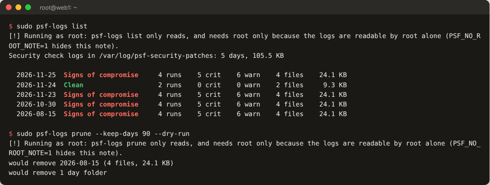

# Output for automation

The scripts in this collection print a report for a person. For monitoring, a watchdog, a ticket system or a language model, they can also write **JSON Lines**: one record per line, every record self-describing. `psf-report.py` turns those records, from one run or hundreds, from one host or many, into a summary, a Markdown report, an HTML page or a PDF.

**Status:** a preview. Six scripts have it in this release: [magento-check.sh](../web-apps/magento/README.md), [nginx-oct2026-check.sh](../servers/nginx/README.md), [expat-check.sh](../system/expat/README.md), [agentic-attack-check.sh](../threats/agentic-attacks/README.md), [linux-kernel-noisytcp-check.sh](../system/linux-kernel/README.md#linux-kernel-noisytcp-check) and [drupal-installer-check.sh](../web-apps/drupal/README.md#drupal-installer-check). The rest follow; a script without it rejects `--output` as an unknown option, so nothing breaks silently. The format is versioned (`"schema": 1`): a later change that could break a reader gets a new number.

| File | What it is |
|---|---|
| `output-block.bash` | The block each script carries: `--output`, the records, read-only mode |
| `psf-output.py` | Keeps that block identical in every script (`--check`, `--write`) |
| `psf-report.py` | Renders records as a summary, plain text, Markdown, HTML or PDF; needs only Python 3 |
| `psf-status.py` | Shows, at a terminal, what the newest records say, like `systemctl status` |
| `psf-logs.py` | Lists the log folder, removes days past their retention, and clears it |
| `psf-run.py` | Runs the configured checks every night: records, reports, retention and alerts |
| `psf.conf.example` | The settings, explained: copy it to `/etc/psf-security-patches/psf.conf` |
| `examples/` | [Example reports](examples/README.md) in every format, made from real runs on a test machine |

## Quick start

```bash
sudo web-apps/magento/magento-check.sh check --output jsonl > magento.jsonl
sudo system/expat/expat-check.sh check --output jsonl > expat.jsonl
python3 automation/psf-report.py magento.jsonl expat.jsonl                     # a short plain-text summary
python3 automation/psf-report.py --format text --out report.txt *.jsonl        # the whole report as plain text
python3 automation/psf-report.py --format md   --out report.md   *.jsonl        # Markdown
python3 automation/psf-report.py --format html --out report.html *.jsonl        # one self-contained web page
python3 automation/psf-report.py --format pdf  --out report.pdf  .              # a PDF of every *.jsonl here
python3 automation/psf-report.py --fail-on crit *.jsonl                          # exit 1 on a critical finding
```

`PSF_OUTPUT=jsonl` in the environment does the same as `--output jsonl`. Without either, a script prints exactly what it always printed.

## The records

Every record carries `schema` (1), `seq` (1, 2, 3 and on, in output order), `type`, `run` (the same for every record of one run), `tool`, `version`, `host`, `command`, `ts` (UTC, ISO 8601) and `msg`. `run` and `seq` together identify a record, for correlation and for dropping duplicates. Records are written when the command ends, in the order the script produced them.

| `type` | What it is | Fields of its own |
|---|---|---|
| `start` | The first record of a run | `script_date`, `euid`, `read_only` |
| `section` | A heading in the script's report | |
| `event` | Something the script judged | `level`, `cve`, and on a warning or a critical finding `kind`, `code`, `path`, `fix` |
| `applicable` | The script found nothing on this host to check | |
| `text` | Any other line the script printed (banners, tables, advice) | |
| `verdict` | The last record of a run | `result`, `exit`, `applicable`, `duration_s`, `counts` |

`level` is `crit`, `warn`, `ok`, `info` or `error` (the script could not do what it was asked). `cve` lists the CVE IDs named in the message. `kind` says what a finding is: `vulnerability` (a flawed version), `exposure` (a setting or a missing guard that lets a flaw be reached), `compromise` (signs that someone already got in), `indicator` (a lead from `hunt` that needs a person to look) or `config`; a script that has not tagged a finding leaves it out. `code` is a stable name for the finding (`MAGENTO_UPLOAD_PHP`) that stays the same while the wording of `msg` improves. `path` is the file or install it is about. `fix` is the page that says what to do.

`result` in the verdict is `clean` (exit 0), `findings` (exit 1) or `undecided` (exit 2: something could not be read or decided, or the command was refused). `applicable` is `false` when the script found nothing on the host to check, `true` when it judged something, and `null` when it cannot tell. `counts` holds the number of events at each level and of text lines.

```json
{"schema":1,"seq":7,"type":"event","run":"web1-magento-check-20261124T221701Z-4711","tool":"magento-check","version":"4.1.0","host":"web1","command":"check","ts":"2026-11-24T22:17:01Z","level":"crit","msg":"1 file(s) in pub/media/custom_options/ are PHP or carry PHP code: treat the store as compromised and run hunt","cve":[],"kind":"compromise","code":"MAGENTO_UPLOAD_PHP","path":"/var/www/shop","fix":"https://privacysafe.app/docs/security-patches/web-apps/magento/"}
{"schema":1,"seq":22,"type":"verdict","run":"web1-magento-check-20261124T221701Z-4711","tool":"magento-check","version":"4.1.0","host":"web1","command":"check","ts":"2026-11-24T22:17:01Z","msg":"findings","cve":[],"result":"findings","exit":1,"applicable":true,"duration_s":0.16,"counts":{"crit":2,"warn":5,"ok":0,"info":4,"error":0,"text":6}}
```

A reader should ignore fields it does not know and treat a missing `kind`, `code` or `path` as unknown.

## Logging practice

The records are meant to sit well in a security logging program. They follow, closely rather than exactly, three references:

- the joint guide *Best Practices for Event Logging and Threat Detection* (ASD's ACSC with CISA, the FBI, the NSA and international partners, August 2024);
- the Audit and Accountability (AU) family of NIST SP 800-53 Rev. 5;
- OMB Memorandum M-26-14 (22 May 2026), which rescinded M-21-31 and asks US federal agencies for risk-based, prioritized logging, with CISA's Logging Reference Architecture (20 August 2026) as its implementation guide.

"Closely" means the record format takes on what these ask of an event record; "not exactly" means a check script is a source of security events, not a logging platform, and some of what they ask is the operator's to do.

| What the guidance asks | What the records do |
|---|---|
| A structured, consistent format | One JSON object per line, the same fields from every tool, a versioned schema |
| Each record says what happened, when, where, who and with what outcome (AU-3) | `type`, `level`, `msg`, `code` and `kind`: what; `ts`: when; `host`, `tool`, `path`: where; `euid` in the start record: who ran it; `result`, `exit` and `counts` in the verdict: the outcome |
| Time stamps in UTC from a synchronized clock (AU-8) | `ts` is UTC in ISO 8601. The clock is the host's: keep NTP or chrony running |
| A unique identifier per event, for correlation and deduplication | `run` and `seq` |
| Logging that does not itself weaken the host | Records go to standard output; nothing is written outside a private temporary file that is removed before output. `PSF_READ_ONLY=1` keeps scheduled runs to reading |
| No secrets in logs (AU-3(3) and privacy) | The tools are written not to print credentials or the contents of files they read, beyond the evidence a finding needs. Records can still hold paths, account names, addresses and quoted log lines: restrict who reads them |

What stays yours, as the operator of the logging platform: collecting the records centrally and in time (AU-6), protecting them from change and deletion (AU-9), keeping them long enough (AU-11; M-26-14 sets retention baselines for US federal agencies, so check its current text if they apply to you), and reviewing them.

Where the records stop short, on purpose or for now:

- `ts` is to the second, not the millisecond the joint guide prefers where a source supports it.
- Records are written when a command ends, not streamed as it runs.
- Records carry no signature or hash chain; integrity is the job of the pipeline that stores them.
- The field names are this format's own, not Elastic Common Schema or OCSF. A suggested mapping to ECS: `ts` to `@timestamp`, `host` to `host.name`, `tool` to `event.provider`, `command` to `event.action`, `code` to `event.code`, `seq` to `event.sequence`, `level` to `log.level`, `msg` to `message`, `cve` to `vulnerability.id`, `path` to `file.path`.

## Read-only mode

`PSF_READ_ONLY=1` refuses every command that changes the host (`mitigate`, `rollback`, `harden` and the like), with or without `--dry-run`, before it starts: exit 2, nothing changed, and with `--output jsonl` an `error` event and a verdict say so. Commands that only read (`check`, `hunt`, `list`, `version`, help) run as usual. It holds in two places. The block refuses those change commands by name, and `lock_for_change`, the function that takes the change lock, refuses at the moment it would take the lock, so a command the script itself treats as a change is stopped even when the block does not know its name. Set it for anything scheduled.

## psf-report

| Format | For |
|---|---|
| `summary` (default) | A terminal, a mail, a chat message: the status, one line per run, every finding that needs attention |
| `text` | The whole report as plain text, wrapped at 100 columns: for a log folder, `less`, `grep` or a mail body |
| `md` | A ticket, a wiki, or the context for a language model: status, the run table, findings with their CVE, code, path and link, a CVE index and, unless `--no-details`, every event |
| `html` | One self-contained page, light and dark, that prints cleanly |
| `pdf` | A printable report (`--paper letter` or `a4`) made with Python alone: no fonts, libraries or programs are needed on the host |

[](examples/screenshots/html-report-light.png)

[](examples/screenshots/pdf-report-page-1.png)

[Example reports](examples/README.md) has every format, the records they were made from, and more screenshots (the dark HTML page, the PDF's last page, the summary in a terminal).

The HTML page and the PDF carry the PrivacySafe logo and colors, links to [privacysafe.app](https://privacysafe.app) (the logo is one), the logging note above, and both contacts as mail links, as in [SECURITY.md](../SECURITY.md): questions and other issues to `help@privacysafe.net` (GPG `7702 BD22 435B 5F3E B00C 1E78 21FB 9DF4 D742 422D`), security issues in these tools to `security@privacysafe.net` (GPG `7E3E C7D6 D965 CF1D 8C76 8F80 74AB DBE3 E3FB C689`). The PDF's metadata names the report, its status and hosts, the tools and CVEs, and PrivacySafe Security Patches with privacysafe.app as author and producer.

Records come from hosts that may be compromised, so psf-report treats every field as hostile text. Every format escapes it, and only addresses psf-report writes itself become links (a tool's page on privacysafe.app and the two mail addresses); a `javascript:` or `data:` address in a record never does. The HTML page runs no script and loads nothing: its content security policy allows inline styles and nothing else, it sends no referrer, and its links open with `noopener`. In Markdown, any address in record text (a URL, `www.`, an email address, or a word that passes for a domain such as `magento-check.sh`) is set as code, so no renderer turns it into a link. A line over 1 MB is skipped, and a message over 4,000 characters is shortened in reports; the `jsonl` format passes records on whole. The logo is the one in `packaging/site/img/privacysafe-logo.svg`, built into psf-report by `packaging/report-logo.py`, so the report needs no file beside it.
| `jsonl` | The records again, merged and checked, for passing on |

The status at the top is the most serious thing any run found: **Signs of compromise**, **Action needed** (a critical finding), **Review** (a warning), **Incomplete** (a run could not decide) or **Clean**. Findings are listed most serious first: signs of compromise, then critical, error and warning, each by kind.

`--fail-on crit` (or `warn`) makes psf-report exit 1 when any run found something at that level, so a cron job or a CI step can act on it. A line that is not a record is counted and skipped. psf-report reads no network and runs no program.

## For system administrators

### Which output for what

| Output | Made by | Use it for |
|---|---|---|
| Plain text (the default) | Each tool | Reading at a terminal; `> tool.txt` keeps one tool's full report as a text file |
| JSON Lines | Each tool, `--output jsonl` | The record of a run: keep it, query it with `jq`, ship it to a log platform or SIEM, give it to a language model, render it with psf-report |
| Short plain text | `psf-report.py` (`summary`) | Cron mail, a chat alert, a ticket title: the status and what needs attention |
| Full plain text | `psf-report.py --format text` | A log folder, `less`, `grep`, a mail body: everything, without markup |
| Markdown | `psf-report.py --format md` | A ticket, a wiki page, the context for a language model |
| HTML | `psf-report.py --format html` | One file to open in a browser or attach to a mail |
| PDF | `psf-report.py --format pdf` | Printing, an archive, an auditor or a customer |
| Status at a glance | `psf-status` | Logging in to a host: what the newest checks found, how long ago, and whether they still run |
| The log folder itself | `psf-logs` | How much is kept, for how long, and clearing it |
| The nightly run | `psf-run` | The checks, records, reports, retention and alerts, from one settings file |

From the packages, the tools are under `/opt/psf-security-patches/`, and `psf-status` and `psf-report` are on the `PATH` (links in `/usr/bin` to `/opt/psf-security-patches/automation/`); from a checkout, the paths are the same relative to the repository. Calling psf-report through `python3`, as the examples here do, also works where `/opt` is mounted `noexec`. Run the tools as root (`sudo`) so they can read everything they check.

### Querying the JSON

Each line is one JSON object, so line tools work on it. With `jq`:

```bash
jq -c 'select(.level == "crit") | {host, tool, msg}' *.jsonl                      # every critical finding
jq -r 'select(.type == "verdict") | [.host, .tool, .result, .exit] | @tsv' *.jsonl   # one line per run
jq -s '.' run.jsonl > run.json        # one JSON array, for a program that cannot read JSON Lines
```

Without `jq`, `grep '"level":"crit"' *.jsonl` finds the same lines.

### A daily check: psf-run

`psf-run` runs the checks, keeps their records and the reports you choose, removes logs past their retention, and alerts when something needs attention. Run it every night from `/etc/cron.d/psf-security-patches`:

```
15 3 * * * root /usr/bin/psf-run --quiet
```

With no configuration it runs every tool that writes records, keeps 90 days in `/var/log/psf-security-patches`, writes `summary.txt`, `report.txt` and `report.pdf` beside the records, and prints an alert (which cron mails to root) when a check finds something critical or a tool fails. On an ordinary night `--quiet` prints nothing. Each day gets its own folder; a second run the same day adds new records files, and the reports, `psf-status` and `psf-logs` count only the newest run of each tool on each host.

[](examples/screenshots/psf-run.png)

```bash
sudo psf-run --dry-run          # what a run would do, changing nothing
sudo psf-run                    # a run now, saying what each tool found
psf-run show-config             # every setting, where its value came from, the tools a run would use
```

### Settings: where logs go, how long they stay, which reports

The settings live in `/etc/psf-security-patches/psf.conf`, which `psf-run`, `psf-status` and `psf-logs` all read. Start from the example, which explains each one:

```bash
sudo install -D -m 0644 /opt/psf-security-patches/automation/psf.conf.example /etc/psf-security-patches/psf.conf
```

| Setting | Default | What it does |
|---|---|---|
| `LOG_DIR` | `/var/log/psf-security-patches` | Where the logs go: a real folder (not a link) that only root can write |
| `KEEP_DAYS` | `90` | Days of logs to keep; older days are removed at the start of each run |
| `FORMATS` | `summary text pdf` | Reports beside the records: `summary`, `text`, `md`, `html`, `pdf`; the `.jsonl` records are always kept |
| `TOOLS` | `auto` | The checks: every tool that writes records, or a list such as `web-apps/magento/magento-check.sh threats/agentic-attacks/agentic-attack-check.sh:hunt` |
| `ALERT_ON` | `crit` | `crit`, `warn` or `never`; a tool that fails is always reported |
| `ALERT_COMMAND` | none | A command that also gets the alert on its input, run without a shell: `mail -s "Security check on %h: %s" root` (`%h` host, `%s` status) |
| `TIMEOUT` | `900` | Seconds one tool may run before it is stopped and reported |
| `ENV` | none | Settings for the tools, such as `SCAN_CONTAINERS=0 HUNT_DAYS=14` |

The file is read, never run: one `NAME = value` per line, and a misspelled or repeated name is an error rather than a setting quietly ignored. `PSF_LOG_DIR` overrides `LOG_DIR` for one command, and `PSF_CONFIG` (or `psf-run --config FILE`) points at another file. To write the logs somewhere else, set `LOG_DIR` once and every command follows.

To run the tools yourself instead, run each with `--output jsonl` into a folder per day and render it with `psf-report`; `psf-status` and `psf-logs` read any folder in that layout.

### Running as root

The checks need root to read everything they look at, and the logs are root's, so `psf-run`, `psf-status` and `psf-logs` are normally run as root, and `psf-report` sometimes. Each one, run as root at a terminal, says why it needs root and what it does with it, and says so again when you are logged in as the root account itself rather than through `sudo`, which records who made a change. `PSF_NO_ROOT_NOTE=1` hides the notes; they never appear in cron or in a pipe. What keeps a run as root safe:

- **Only root's code runs as root.** Each of these programs, the `psf-report.py` it loads, every tool `psf-run` starts and the program `ALERT_COMMAND` names must be root's, with every folder above it root's and writable by no other account (a sticky folder such as `/tmp` excepted). Otherwise it refuses, naming the file, because whoever can change that file would control the run. Install the package, whose files are root's, or run a copy as the account that owns it.
- **The settings file is treated like code.** As root it must be root's and writable by no other account. `ENV` cannot set `PATH`, `LD_*`, `HOME`, `TMPDIR`, `PSF_READ_ONLY` or similar; `TOOLS` can name only tools inside the collection.
- **The checks only read.** `psf-run` starts every tool with `PSF_READ_ONLY=1`, a fixed `PATH`, no input and its own time limit; a tool that runs too long is stopped with everything it started.
- **Nothing is written through a link.** The log folder must be a real folder that only its owner can write; each day's records go into a new private folder and each records file is created new. A report written with `psf-report --out` goes through a new file of an unguessable name, readable by its owner only, renamed into place.
- **Records cannot be forged through a tool's output.** Each run marks its own records with a secret made for that run, so a line a tool prints (a file name or a log line an intruder chose) stays text, however much it looks like a record.
- **Untrusted files cannot stall a reader.** In a log folder only regular files are read (not links, devices or pipes), and a file over 256 MB is skipped.

### At a glance: psf-status

`sudo psf-status` reads the newest day in `/var/log/psf-security-patches` and shows what it found, the way `systemctl status` shows a service: one line of status, when the checks last ran, one line per tool, the findings most serious first, and how the earlier days went.

[](examples/screenshots/psf-status.png)

When all is well it is short and green:

[](examples/screenshots/psf-status-clean.png)

Without colors, as in a mail or a file, the same screen reads:

```
● Security checks on 2 hosts: Signs of compromise
      Logs: /var/log/psf-security-patches/2026-11-25 (4 runs), newest of 3 days
  Last run: Wed 2026-11-25 06:00:07 UTC; 2h 9min ago
     Hosts: db1.example, web1.example
   Summary: 5 critical findings, 6 warnings in 2 of 4 runs; 1 found nothing to check here

    TOOL                        COMMAND  RESULT     CRIT  WARN  WHEN      HOST
  ● expat-check 1.2.0           check    findings      3     1  06:00:05  db1.example
  ● magento-check 4.1.0         check    findings      2     5  06:00:00  web1.example
  ● agentic-attack-check 2.1.0  hunt     clean         0     0  06:00:07  db1.example
  ○ nginx-oct2026-check 1.1.0   check    clean         0     0  06:00:03  web1.example  nothing to check here

Needs attention, most serious first (3 of 11):
  CRIT  (compromise) web1.example magento-check: 1 file(s) in pub/media/custom_options/ are PHP ...
  CRIT  (exposure) web1.example magento-check: pub/media/custom_options/.htaccess is missing ...
  CRIT  db1.example expat-check: /usr/lib/x86_64-linux-gnu/libexpat.so.1.9.1: expat 2.6.1 is ...

Earlier: 2026-11-24 Clean · 2026-11-23 Signs of compromise (5 crit, 6 warn)

Full report: psf-report --format text /var/log/psf-security-patches/2026-11-25
```

On a terminal the dots and the status are colored (red, yellow, magenta, green; grey for a tool that found nothing to check) and long lines are cut to its width; `-l` shows them whole, and `NO_COLOR` or `--color never` turns color off. When the newest run is older than 36 hours (`--stale HOURS`), it says the logs are stale and asks whether the daily check still runs.

| Option | What it does |
|---|---|
| `-n N` | List N findings (default 10; 0 for none) |
| `--days N` | Earlier days on the history line (default 7) |
| `--tool NAME`, `--host NAME` | Only those runs (repeatable) |
| `FOLDER` or `FILE ...` | Another log folder, or `.jsonl` files, instead of `/var/log/psf-security-patches` |
| `PSF_LOG_DIR=FOLDER` | Where to look when no folder is given (default `/var/log/psf-security-patches`) |

It exits 0 when the newest runs are clean and recent, 1 when something needs attention (a finding, an error, an undecided run or stale logs), 2 on a usage or read error, and 3 when there are no records (as on a host where the daily check has not run yet), so `psf-status -n 0 >/dev/null || ...` works in a script or a login message. The logs are readable by root only, so run it with `sudo`; it says so when it cannot read them. The example in [examples/](examples/README.md) is `example-status.txt`.

### Keeping and clearing logs

`psf-logs` looks after the log folder: how much there is, how long it stays, and clearing it.

```bash
sudo psf-logs list                                 # every day: its status, runs, files and size, and the total
sudo psf-logs prune --keep-days 90 --dry-run       # what would go
sudo psf-logs prune --keep-days 90                 # remove the days older than 90 (the default)
sudo psf-logs clear --dry-run                      # what clearing would remove
sudo psf-logs clear --yes                          # remove every day of logs
```

`--keep-days N` keeps today and the N-1 days before it. Choose N from your own risk assessment, contracts and the law that applies to you, not from this default: logs that would show how an intruder got in are worth keeping longer than the time an intrusion can go unnoticed, and records schedules or privacy law can require a longer or a shorter period. For US federal agencies, OMB M-26-14 sets retention baselines; check its current text. `psf-run` prunes at the start of every run, so retention is one setting (`KEEP_DAYS` in `psf.conf`).

It removes only what `psf-run` writes: day folders named `YYYY-MM-DD` that hold plain files. Anything else in the folder, a day folder that holds another folder, and every symbolic link are reported and left alone; a link inside a day folder is removed as a link, and what it points to is never touched. It refuses a log folder that is itself a link, that accounts other than its owner can write to, or, run as root, that root does not own. Every removal is written to syslog (facility `authpriv`) as well as to its output, because removing logs is itself a security event. `PSF_READ_ONLY=1` refuses `prune` and `clear`, and `clear` needs `--yes`. It exits 0 when done, 1 when something was left in place, and 2 on a usage error or a refusal. `--quiet` prints only what needs a person (a folder left in place, an error), so a cron mail stays empty on an ordinary night; removals still go to syslog. `--dir FOLDER` or `PSF_LOG_DIR` points it at another log folder.

[](examples/screenshots/psf-logs.png)

### Several hosts

Each host keeps its own folder. Copy them to one machine and render one report over all of them:

```bash
rsync -a web1:/var/log/psf-security-patches/ /srv/psf/web1/
rsync -a db1:/var/log/psf-security-patches/  /srv/psf/db1/
python3 automation/psf-report.py --format html --out fleet.html /srv/psf/*/2026-11-25
```

### A log platform or SIEM

Point the log shipper the host already runs at `/var/log/psf-security-patches/*/*.jsonl` as a JSON-lines input. `run` and `seq` identify each record; [Logging practice](#logging-practice) maps the fields to the Elastic Common Schema.

### What it needs

- **JSON Lines from the tools:** Bash and seven basic commands the block calls (`cat`, `date`, `dirname`, `mktemp`, `awk`, `rm`, `uname`), besides what each tool needs for its own checks.
- **Every report, `psf-run`, `psf-status` and `psf-logs`:** Python 3.7 or newer and its standard library, nothing else: no packages to install, no network access, no other program.
- **HTML:** one file with its styles and the logo inside it. It loads nothing from anywhere and runs no script: its content security policy forbids both.
- **PDF:** one file. It uses Helvetica and Courier, two of the standard fonts every PDF viewer supplies, so the fonts are not embedded; a viewer may draw them with an equivalent font of the same widths. Archiving as PDF/A would need embedded fonts, which this report does not do. The PDF holds no script, form, attachment or remote content; its only links are to privacysafe.app and the two mail addresses.
- **Plain text, Markdown and the summary:** UTF-8 text with every control character removed, so a record from a compromised host cannot send commands to the terminal that shows it.

## How a script writes them

The block sits right after the script's own output helpers and redefines them in jsonl mode: `ok` and `pass` become `ok` events, `info`, `inf`, `note` and `tip` `info`, `warn` and `caution` `warn`, `bad` and `fail` `crit`, `die` an `error`, `step` and `section` a section. A finding can carry more by setting variables on the call, which the text output ignores:

```bash
PSF_KIND=compromise PSF_CODE=MAGENTO_UPLOAD_PHP PSF_PATH="$root" bad "1 file(s) in pub/media/custom_options/ are PHP"
psf_not_applicable "no Magento install found on the host or in running containers"
```

In jsonl mode the script's output goes to a private temporary file (made with `mktemp`, mode 0600) that is opened and removed before the records are written, so nothing is left behind even if the reader stops early. The script's own `EXIT` traps still run. Nothing is executed again and no other program is started.

To add the block to a script, or refresh it after `output-block.bash` changes:

```bash
python3 automation/psf-output.py --write web-apps/drupal/drupal-core-check.sh
python3 automation/psf-output.py --check          # every script that has the block carries the current one
```

## Before you run it

The records say what a script read on the host, exactly as its text report does: a finding is a reason to look, not proof. Keep the JSON Lines files private where they name paths or accounts you would not publish.

---

## ⚠️ Important notice

These scripts are used on our production systems and undergo testing, but they may require adaptation for other environments. Review the source code before running any script, test changes in a non-production environment where possible, and maintain current backups. This software is provided without warranty.

## 🏛️ Support PrivacySafe Foundation

[PrivacySafe Foundation](https://privacysafe.foundation) is a 501(c)(3) nonprofit public charity supporting Free/Libre and Open Source Software (FLOSS), cybersecurity education, decentralized technology, documentation, standards work, and public-interest privacy and security research.

Security work doesn't stop when a disclosure drops at midnight. If this repository helped you protect your users, please help us keep doing it:

* **[Donate directly to the Foundation](https://privacysafe.foundation)**
* [Open Collective](https://opencollective.com/privacysafe)
* [Ko-fi](https://ko-fi.com/R6R1194HN7)
* [Liberapay](https://liberapay.com/PrivacySafe/donate)

The Foundation website provides options for card donations, PayPal/Venmo, cryptocurrency, checks, and other forms of support. Donations are often tax-deductible in the USA. Federal EIN: 41-5237617.

## 🤝 Contributing

Found a bug in a script, or have a mitigation that belongs here? Please fork and submit a focused pull request.

⚠️ **Do not report unpatched vulnerabilities in a public issue.** Follow our [security policy](../SECURITY.md) instead. Never send sensitive information through ordinary direct messages or unencrypted email.

- **Contribution terms:** [`CONTRIBUTING.md`](../CONTRIBUTING.md)
- **Code of Conduct:** [`CODE_OF_CONDUCT.md`](../CODE_OF_CONDUCT.md)
- **AI Contribution Policy:** [`AI_POLICY.md`](../AI_POLICY.md)
- **Security and vulnerability reporting:** [`SECURITY.md`](../SECURITY.md)

## 🔐 More from PrivacySafe

* **[PrivacySafe](https://privacysafe.app):** Privacy-by-design software for home, teams, and organizations. Sign up free, no phone number required.
* **[Bits On Tape](https://bitsontape.com):** Our newsletter covering cybersecurity, privacy, FLOSS, AI, and digital culture.
* **[Ivy Cyber](https://ivycyber.com):** Hosting, enterprise deployment, training, and technical support, including help hardening your own infrastructure.

## ⚖️ License

<a href="https://creativecommons.org/publicdomain/zero/1.0/" rel="nofollow"></a>

Security patches belong to everyone. To the extent possible under law, <a href="https://ivycyber.com" rel="nofollow">Ivy Cyber LLC</a> has waived all copyright and related or neighboring rights to this repository, including its scripts and documentation, under the <a href="https://creativecommons.org/publicdomain/zero/1.0/" rel="nofollow">Creative Commons CC0 1.0 Universal Public Domain Dedication</a> (`CC0-1.0`). Feel free to copy, remix, and share. If you'd like to give back, please [donate to PrivacySafe Foundation](https://privacysafe.foundation) 501c3 nonprofit.

See [`NOTICE`](../NOTICE) and [`LICENSE`](../LICENSE). Third-party components retain their original copyrights and licenses.

CC0 does not waive trademark or patent rights. PrivacySafe® and 3NWeb® are registered trademarks. PrivacySafe Foundation™ and Ivy Cyber™ are pending trademarks. This dedication does not grant permission to use these marks in a manner that suggests sponsorship, endorsement, affiliation, or origin.
