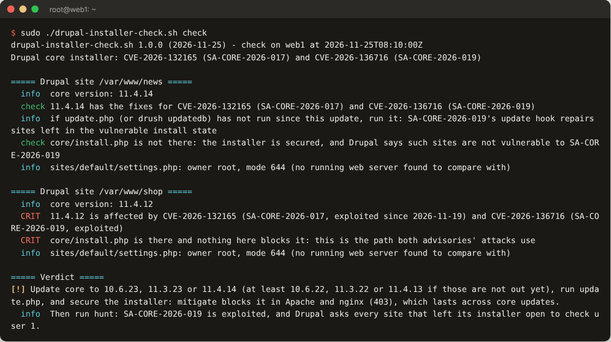
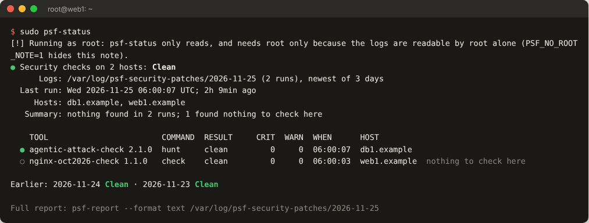
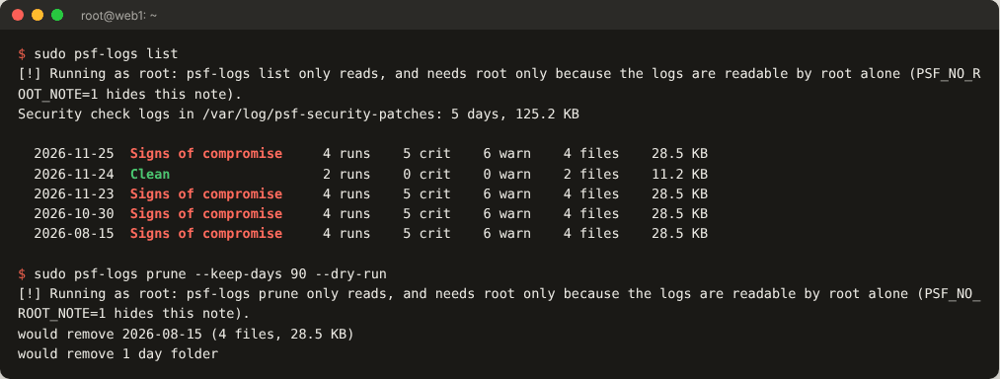
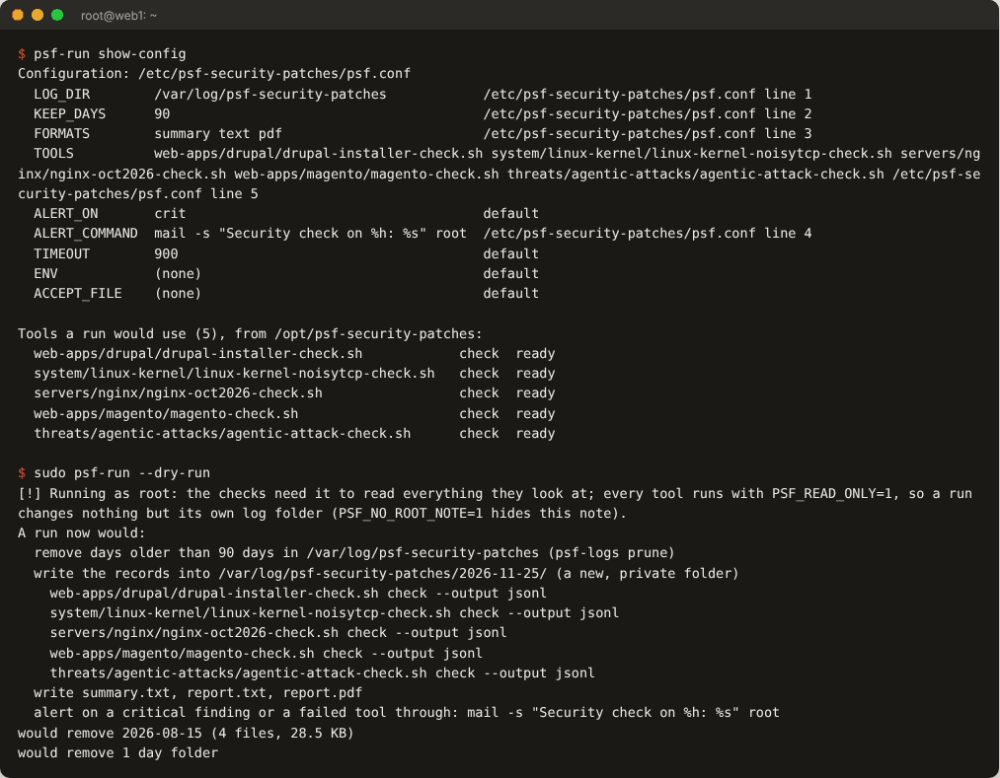
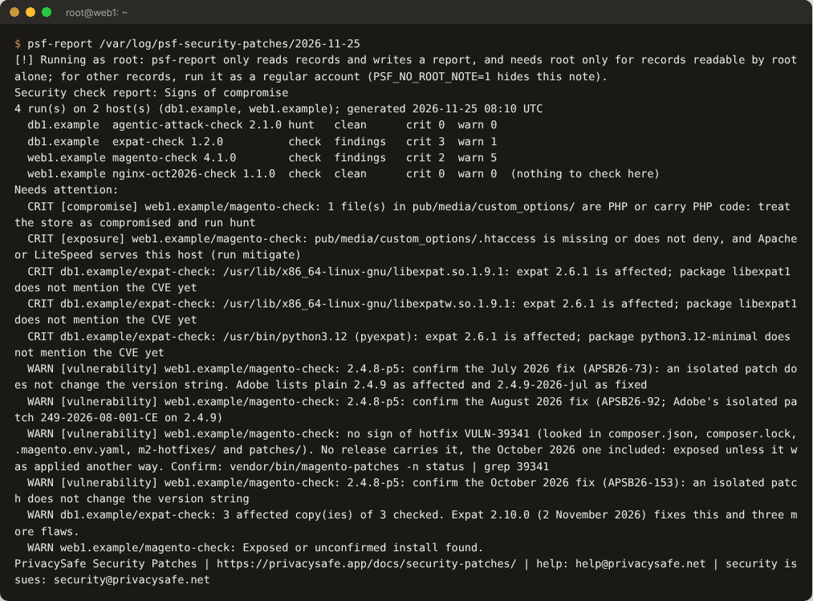
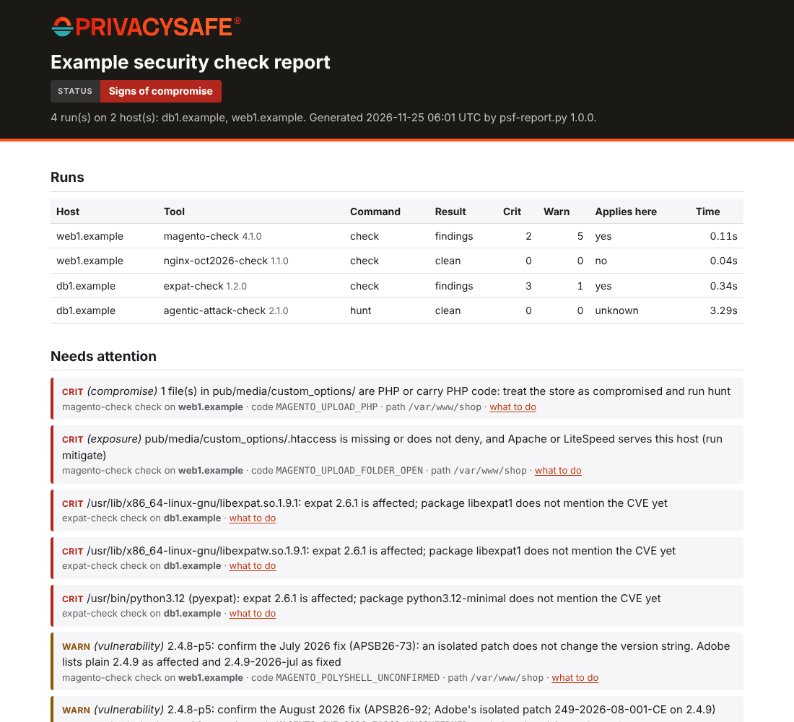
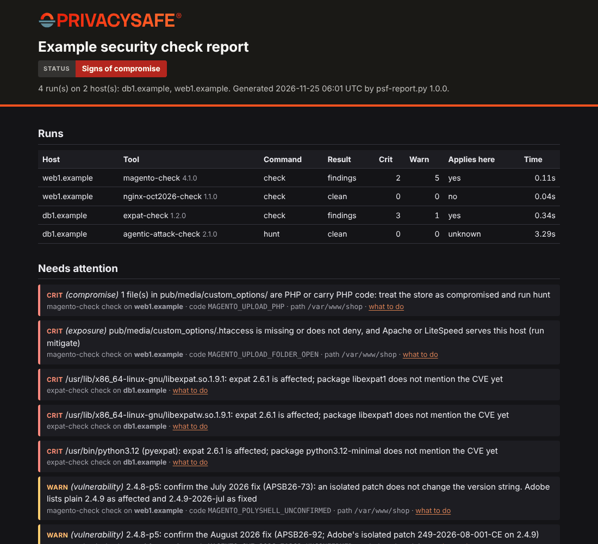
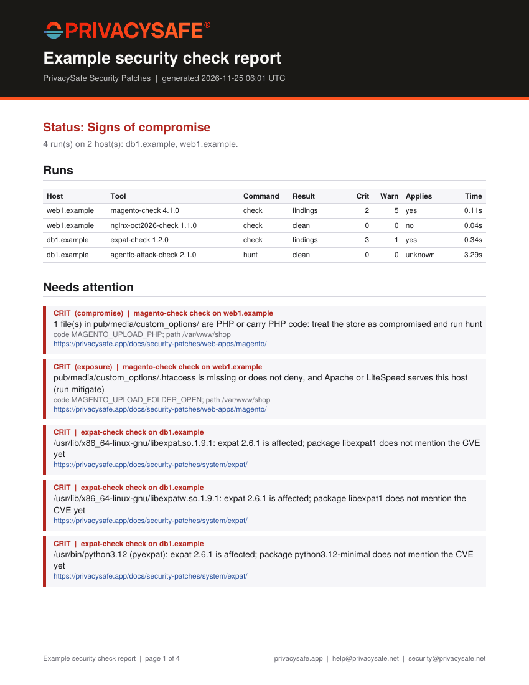
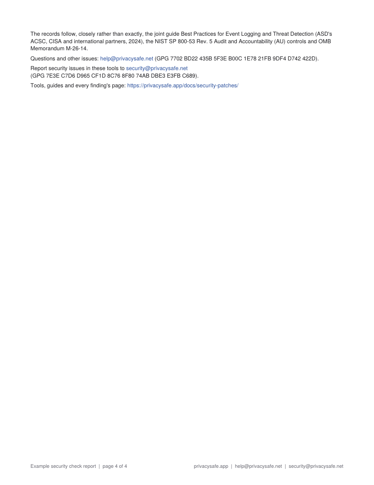

# Example reports

What `psf-report.py` makes from the records the tools write with `--output jsonl`: four runs on two hosts, in every format.

| File | What it is |
|---|---|
| [`example-records.jsonl`](example-records.jsonl) | The records: 68 lines from four runs, `magento-check.sh check` and `nginx-oct2026-check.sh check` on `web1.example`, `expat-check.sh check` and `agentic-attack-check.sh hunt` on `db1.example` |
| [`example-summary.txt`](example-summary.txt) | `--format summary`: the short plain text a cron job would mail |
| [`example-report.txt`](example-report.txt) | `--format text`: the whole report as plain text |
| [`example-status.txt`](example-status.txt) | `psf-status`: the overview at a terminal (without its colors) |
| [`example-report.md`](example-report.md) | `--format md`: for a ticket, a wiki or a language model |
| [`example-report.html`](example-report.html) | `--format html`: one self-contained page; download it and open it in a browser |
| [`example-report.pdf`](example-report.pdf) | `--format pdf`: the printable report |

## Screenshots

What an administrator sees, taken from the files above. The terminal ones are `psf-status` and `psf-report` run in a 120-column terminal on these records, laid out the way the daily check lays them out.

**A check run by hand: `sudo ./drupal-installer-check.sh check`** on two example Drupal sites made for the purpose, one affected and open, one patched:

[](screenshots/check-drupal-installer.png)

**Another: `sudo ./linux-kernel-noisytcp-check.sh check`** on an example Debian 12 host made for the purpose, with an affected kernel:

[](screenshots/check-noisytcp.png)

The host name, times, paths and listeners in these two are examples, not a real server's.

**`sudo psf-status` when something needs attention:**

[](screenshots/psf-status.png)

**`sudo psf-status` when everything is clean:**

[](screenshots/psf-status-clean.png)

**`sudo psf-logs list` and a dry run of the retention:**

[](screenshots/psf-logs.png)

**`psf-run show-config` and `sudo psf-run --dry-run`:**

[](screenshots/psf-run.png)

**`psf-report` (the short summary) in a terminal:**

[](screenshots/psf-report-summary.png)

**The HTML report, light and dark** (the page follows the browser's setting):

[](screenshots/html-report-light.png)

[](screenshots/html-report-dark.png)

**The PDF report, first and last page:**

[](screenshots/pdf-report-page-1.png)

[](screenshots/pdf-report-last-page.png)

`packaging/report-screenshots.py --write` takes them again; `--check` fails when an example or the code they show has changed since they were taken (`screenshots/MANIFEST.txt`).

## How they were made

The records are real output of the four tools, run on a test machine. Only what identifies that machine was replaced: the host names (now `web1.example` and `db1.example`, a domain kept for examples), the path of the store (now `/var/www/shop`) and the times (now 25 November 2026 from 06:00 UTC, each run's own spacing kept). Every finding, message, count and exit code is what the tools reported.

The Magento store is a test install of 2.4.8-p5 made for the purpose, with a PHP file placed in `pub/media/custom_options/` and no `.htaccess` guard. That is why it shows signs of compromise: no real store was involved. The Expat findings are real for the test machine, whose libexpat 2.6.1 is affected. nginx was not installed there, so its check reports that it found nothing to check.

To make the reports again after a change to `psf-report.py`:

```bash
python3 packaging/report-examples.py --write     # render every example from example-records.jsonl
python3 packaging/report-examples.py --check     # exit 1 if an example differs from what psf-report gives now
```

The reports are rendered with `SOURCE_DATE_EPOCH` set to a minute after the last record, so the same records always give the same files, byte for byte. `--import` makes new records from new runs and replaces the same details (`packaging/report-examples.py` says how). The guide to the format is [Output for automation](../README.md).

---

## ⚠️ Important notice

These scripts are used on our production systems and undergo testing, but they may require adaptation for other environments. Review the source code before running any script, test changes in a non-production environment where possible, and maintain current backups. This software is provided without warranty.

## 🏛️ Support PrivacySafe Foundation

[PrivacySafe Foundation](https://privacysafe.foundation) is a 501(c)(3) nonprofit public charity supporting Free/Libre and Open Source Software (FLOSS), cybersecurity education, decentralized technology, documentation, standards work, and public-interest privacy and security research.

Security work doesn't stop when a disclosure drops at midnight. If this repository helped you protect your users, please help us keep doing it:

* **[Donate directly to the Foundation](https://privacysafe.foundation)**
* [Open Collective](https://opencollective.com/privacysafe)
* [Ko-fi](https://ko-fi.com/R6R1194HN7)
* [Liberapay](https://liberapay.com/PrivacySafe/donate)

The Foundation website provides options for card donations, PayPal/Venmo, cryptocurrency, checks, and other forms of support. Donations are often tax-deductible in the USA. Federal EIN: 41-5237617.

## 🤝 Contributing

Found a bug in a script, or have a mitigation that belongs here? Please fork and submit a focused pull request.

⚠️ **Do not report unpatched vulnerabilities in a public issue.** Follow our [security policy](../../SECURITY.md) instead. Never send sensitive information through ordinary direct messages or unencrypted email.

- **Contribution terms:** [`CONTRIBUTING.md`](../../CONTRIBUTING.md)
- **Code of Conduct:** [`CODE_OF_CONDUCT.md`](../../CODE_OF_CONDUCT.md)
- **AI Contribution Policy:** [`AI_POLICY.md`](../../AI_POLICY.md)
- **Security and vulnerability reporting:** [`SECURITY.md`](../../SECURITY.md)

## 🔐 More from PrivacySafe

* **[PrivacySafe](https://privacysafe.app):** Privacy-by-design software for home, teams, and organizations. Sign up free, no phone number required.
* **[Bits On Tape](https://bitsontape.com):** Our newsletter covering cybersecurity, privacy, FLOSS, AI, and digital culture.
* **[Ivy Cyber](https://ivycyber.com):** Hosting, enterprise deployment, training, and technical support, including help hardening your own infrastructure.

## ⚖️ License

<a href="https://creativecommons.org/publicdomain/zero/1.0/" rel="nofollow"></a>

Security patches belong to everyone. To the extent possible under law, <a href="https://ivycyber.com" rel="nofollow">Ivy Cyber LLC</a> has waived all copyright and related or neighboring rights to this repository, including its scripts and documentation, under the <a href="https://creativecommons.org/publicdomain/zero/1.0/" rel="nofollow">Creative Commons CC0 1.0 Universal Public Domain Dedication</a> (`CC0-1.0`). Feel free to copy, remix, and share. If you'd like to give back, please [donate to PrivacySafe Foundation](https://privacysafe.foundation) 501c3 nonprofit.

See [`NOTICE`](../../NOTICE) and [`LICENSE`](../../LICENSE). Third-party components retain their original copyrights and licenses.

CC0 does not waive trademark or patent rights. PrivacySafe® and 3NWeb® are registered trademarks. PrivacySafe Foundation™ and Ivy Cyber™ are pending trademarks. This dedication does not grant permission to use these marks in a manner that suggests sponsorship, endorsement, affiliation, or origin.
