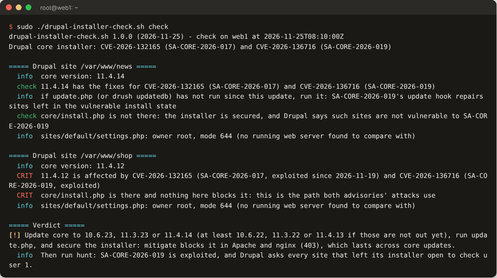

# Drupal: core installer CVE-2026-132165 and CVE-2026-136716, Webform CVE-2026-96355, core Field UI CVE-2026-108097 and Entity List CVE-2026-108099

Part of the [PrivacySafe Security Patches](../../README.md) collection.

<a name="drupal-webform-check"></a>

## Drupal Webform check

**Script:** [`web-apps/drupal/drupal-webform-check.sh`](drupal-webform-check.sh)

The Webform module does not sufficiently exclude certain format templates from token replacement. An attacker can submit data that is evaluated as template code when a submission is rendered. Depending on site configuration and the modules that are enabled, that can mean information disclosure, stored cross-site scripting or remote code execution. Webform is among the most widely installed Drupal modules and its forms sit on public pages. Drupal core is not affected by this Webform flaw. For the separate core flaw, see [Drupal core check](#drupal-core-check) below.

| | |
|---|---|
| CVE | CVE-2026-96355 (Drupal advisory SA-CONTRIB-2026-175, published 23 September 2026) |
| Severity | Critical, 18/25 on the Drupal Security Team's scale (`AC:Basic/A:None/CI:All/II:All/E:Theoretical/TD:Uncommon`) |
| Affected | Webform below 6.2.12, and 6.3.0 up to 6.3.1 |
| Fixed | 6.2.12 on the 6.2.x branch, 6.3.1 on the 6.3.x branch |
| Condition | The advisory says an affected webform must be configured with a custom multiple-value item format that includes submission-value tokens. Some impacts also depend on other enabled modules or site configuration |
| Same day | The same Webform releases close 19 other Webform advisories published the same day (numbered between SA-CONTRIB-2026-154 and 174), so updating is worth doing even where this condition is not met |

## Quick start

1. Download the script. The repository is mirrored on GitHub and Codeberg; pick a base URL.

   ```bash
   # BASE from GitHub:   https://raw.githubusercontent.com/PrivacySafe/security-patches/refs/heads/main
   # BASE from Codeberg: https://codeberg.org/PrivacySafe/security-patches/raw/branch/main
   # curl -fLO "$BASE/web-apps/drupal/drupal-webform-check.sh"
   curl -fLO https://raw.githubusercontent.com/PrivacySafe/security-patches/refs/heads/main/web-apps/drupal/drupal-webform-check.sh
   ```

2. Read it before running it, then make it executable.

   ```bash
   less drupal-webform-check.sh
   chmod +x drupal-webform-check.sh
   ```

3. Check this host. By default it searches `/var/www /srv /opt /home`; pass directories to narrow it.

   ```bash
   ./drupal-webform-check.sh check
   ./drupal-webform-check.sh check /var/www/drupal
   ```

## Commands

| Command | What it does |
|---|---|
| `check [DIR ...]` (default) | Reads the Webform version from `composer.lock` and from each module's own `webform/webform.info.yml`, compares it with the fixed versions, and scans exported configuration (`webform.webform.*.yml`) for elements that use a custom multiple-value format |
| `version` | Prints the script version |

Exit codes: `0` nothing affected, `1` an affected version, a version that cannot be read or parsed, or a release outside the advisory's range (end of life, not confirmed clear) was found, `2` bad arguments.

Commands that change the host need root. Run them with `sudo` from an admin account, not from a root login, so the change is recorded against a person. The script stops and prints the exact command if you forget:

```bash
sudo ./drupal-core-check.sh mitigate --dry-run
sudo ./drupal-core-check.sh mitigate
sudo ./drupal-core-check.sh rollback
```

## How to read the result

- Affected version: update, even if the configuration scan finds nothing. The configuration condition is how the advisory limits the code execution path, not a reason to leave the module unpatched.
- A 6.3.0 pre-release (for example `6.3.0-rc2`) belongs to the 6.3 branch and is reported as affected.
- Development versions (`dev-6.x`) and **legacy numbering** (`8.x-5.x`, `7.x-4.x`) cannot be compared mechanically. The script prints a warning and points you at the advisory.
- Configuration findings come from exported configuration. The script looks for `format_items: custom` in exported configuration. It reports the webform and how many elements use it, and it does not decide whether the custom format contains submission-value tokens, so open the flagged webforms and look.
- Configuration stored only in the database is not visible to a file scan. On a live site, run this from the Drupal root to list webforms with a custom format:

  ```bash
  drush config:list --prefix=webform.webform. --format=list | while read -r c; do
    drush config:get "$c" elements 2>/dev/null | grep -qE "format_items.*custom" && echo "$c"; done
  ```

## Fixing it

```bash
composer require 'drupal/webform:^6.2.12'    # on the 6.2.x branch
composer require 'drupal/webform:^6.3.1'     # on the 6.3.x branch
drush updb -y && drush cr
```

Until you can update, remove custom multiple-value item formats that include submission-value tokens from your webforms. That is the condition the advisory names, so it is the configuration to take out of the picture first.

## Sources

- [Drupal advisory SA-CONTRIB-2026-175](https://www.drupal.org/sa-contrib-2026-175)
- [Webform 6.3.1 release](https://www.drupal.org/project/webform/releases/6.3.1)

<a name="drupal-core-check"></a>

## Drupal core check

**Script:** [`web-apps/drupal/drupal-core-check.sh`](drupal-core-check.sh)

The Field UI module in Drupal core does not properly validate PHP callbacks while it renders its tables. Drupal rates it Critical, 19 out of 25. **Drupal core alone is not directly exploitable**: the callbacks have to be reachable from data an attacker controls, and that happens through contributed modules or custom code. At least one such path needs no authentication, which is why the Drupal Security Team announced the release in advance (PSA-2026-10-12) and asked for emergency patching.

| | |
|---|---|
| CVE | CVE-2026-108097 (advisory SA-CORE-2026-014, published 14 October 2026) |
| Severity | Critical, 19/25 by Drupal's scale; reported as roughly 9.8 by CVSS-style trackers |
| Affected | Drupal core 8.9.0 up to 10.6.19, 11.0.0 up to 11.3.19, 11.4.0 up to 11.4.10, and Drupal 12 before 12.0.0-beta2 |
| Fixed | **10.6.19, 11.3.19, 11.4.10** and 12.0.0-beta2 |
| Move to | **A supported branch.** 10.5.x and earlier, 11.2.x and earlier, 9.x and 8.9.x are end of life |
| Workaround | Drupal's own: uninstall the core Field UI module (`drush pm:uninstall field_ui`). It covers only this advisory. The same release fixes two other core issues that only the update fixes |
| Exploit | At disclosure, no public exploit for real sites existed. A research write-up with laboratory artifacts has been published, so treat "no public exploit" as a statement about that moment |
| Related | The contributed Entity List module has its own critical flaw, CVE-2026-108099, described below. **Updating core does not fix it** |

### Entity List: CVE-2026-108099

The contributed Entity List module (project `entity_list`) builds lists of entities without Views. Versions before 3.0.10 have a critical remote code execution flaw, rated 19/25 by Drupal. Like the core flaw, it is not directly exploitable by itself, but multiple serious exploit paths exist with other contributed modules, **at least one needs no authentication**, and custom code may expose it.

| | |
|---|---|
| CVE | CVE-2026-108099 (advisory SA-CONTRIB-2026-218, 14 October 2026) |
| Severity | Critical, 19/25 |
| Affected | Entity List before 3.0.10 |
| Fixed | **Entity List 3.0.10** |
| Needs its own update | Updating Drupal core does not replace the module's vulnerable code |

The script checks Entity List on **every site it finds, whatever the core version is**, because a fully patched core with an old Entity List is still exposed. It reads the version from the module's `info.yml` (the drupal.org packaging format, with or without an `8.x-` prefix) and falls back to `composer.lock`. Anything before 3.0.10, including older majors, fails. 3.0.10 and later (compared numerically, so `3.0.100` is newer) passes. A development version or an unreadable version is reported for manual review.

## Quick start

1. Download the script. The repository is mirrored on GitHub and Codeberg; pick a base URL.

   ```bash
   # BASE from GitHub:   https://raw.githubusercontent.com/PrivacySafe/security-patches/refs/heads/main
   # BASE from Codeberg: https://codeberg.org/PrivacySafe/security-patches/raw/branch/main
   # curl -fLO "$BASE/web-apps/drupal/drupal-core-check.sh"
   curl -fLO https://raw.githubusercontent.com/PrivacySafe/security-patches/refs/heads/main/web-apps/drupal/drupal-core-check.sh
   ```

2. Read it before running it, then make it executable.

   ```bash
   less drupal-core-check.sh
   chmod +x drupal-core-check.sh
   ```

3. Check this host. By default it searches `/var/www /srv /opt /home`; pass directories to narrow it.

   ```bash
   ./drupal-core-check.sh check
   ./drupal-core-check.sh check /var/www/mysite
   ```

### Commands

| Command | What it does |
|---|---|
| `mitigate [--dir DIR] [--dry-run] [--force]` | **Changes the host (root).** Drupal's own published workaround for CVE-2026-108097: runs `drush pm:uninstall field_ui` on every site whose core is affected and where the **live** site (not only exported configuration) still has Field UI enabled. drush runs as the owner of the site, never as root, and is looked up in the project's `vendor/bin`, then `PATH`. The field management screens are unavailable until you reinstall Field UI. It covers this advisory only; update core as well. `--force` uninstalls on a core outside the affected range |
| `rollback [--dry-run]` | Reinstalls Field UI (`drush pm:install field_ui`) on the sites `mitigate` changed |
| `check [DIR ...]` (default) | Finds `core/lib/Drupal.php` (so it works whether the docroot is `web/`, `docroot/` or the project root), reads `VERSION`, compares it with the fixed releases, reads exported configuration (`core.extension.yml`) to see whether `field_ui` is enabled, and looks for the contributed Entity List module |
| `version` | Prints the script version |

Exit codes: `0` nothing exposed, `1` an affected site is exposed, unverifiable, or on an end-of-life branch that cannot be patched, `2` bad arguments.

### How to read the result

- Affected version and Field UI enabled: exposed. Update now.
- Affected version and Field UI not enabled in exported configuration: the script reports Drupal's workaround as in effect and exits `0`, but still says to update, because the workaround covers only this advisory.
- Affected version and no exported configuration: the script cannot tell whether Field UI is on (configuration may live only in the database), so it treats the site as exposed and prints the `drush` command to check on the live site.
- End-of-life branches (11.2 and earlier, 10.5 and earlier, 9, 8.9): always exit `1`, whatever Field UI says. Upgrade to a supported branch.
- Entity List before 3.0.10, or with an unreadable or development version: exits `1`, even when core is fully patched. Update the module with `composer update drupal/entity_list`.
- Drupal 7 is outside this advisory's range and has its own long-term-support path. The script warns and does not judge it. A Drupal 7 site has no `core/lib/Drupal.php`, so it is not found at all.
- A `composer.lock` that disagrees with the installed core: the installed copy wins, and the script says so.

### Fixing it

```bash
composer update 'drupal/core-*' --with-all-dependencies   # to 10.6.19, 11.3.19 or 11.4.10
drush updb && drush cr
```

If you cannot update today, uninstall Field UI (`drush pm:uninstall field_ui`). That is Drupal's published workaround. Afterwards, review contributed and custom code that passes request data into render arrays or field configuration, since that is where the real exposure sits.

### Sources

- [Drupal security advisory SA-CORE-2026-014](https://www.drupal.org/sa-core-2026-014)
- [Pantheon: Drupal core security update](https://docs.pantheon.io/release-notes/2026/10/drupal-core-security-update)

<a name="drupal-installer-check"></a>

## Drupal core installer: site takeover through install.php (CVE-2026-132165, CVE-2026-136716)

**Script:** [`web-apps/drupal/drupal-installer-check.sh`](drupal-installer-check.sh)

Drupal core ships `core/install.php`, the installer, and it stays on the site after installation. Under conditions Drupal does not publish, an anonymous visitor can use it to reinstall a running site: a site takeover, or code execution. Two advisories cover it, and both are exploited.

| | SA-CORE-2026-017 | SA-CORE-2026-019 |
|---|---|---|
| CVE | CVE-2026-132165 ("Fail2Install") | CVE-2026-136716 |
| Published | 18 November 2026 (updated 21 November) | 25 November 2026 |
| Drupal's rating | Highly critical, 20/25 (`AC:Complex/A:None/CI:All/II:All/E:Exploit/TD:Uncommon`) | Highly critical, 21/25 (`AC:Basic/A:None/CI:All/II:All/E:Exploit/TD:Uncommon`) |
| Exploited | On live sites from 2026-11-19 19:00 UTC; on CISA's KEV list since 24 November (federal deadline 27 November) | Yes, Drupal says, in the wild |
| Fixed in | 10.6.22, 11.3.22, 11.4.13 | The affected range ends before 10.6.23, 11.3.23 and 11.4.14; then run `update.php` |

SA-CORE-2026-019 is the reason to secure the installer even on a patched site: sites "in unusual or incomplete install states" stayed open to takeover after the SA-CORE-2026-017 fix, production sites included, and nothing in the interface shows it. Drupal: "If you have already secured the installer, you are not vulnerable." An update hook repairs sites in that state, so after updating run `update.php` (or `drush updatedb`). Its solution text still names 10.6.22, 11.3.22 and 11.4.13 while the new releases were being packaged; the script judges by the affected range. Drupal 11.2 and below, 10.5 and below, 9 and 8 are end of life and get no fix. Drupal also says that some, but not all, exploit paths are closed when the web server cannot write to or change the permissions of `settings.php`. Drupal Steward protects its subscribers from the known attack vectors.

### Quick start

```bash
curl -fLO https://raw.githubusercontent.com/PrivacySafe/security-patches/refs/heads/main/web-apps/drupal/drupal-installer-check.sh
less drupal-installer-check.sh
chmod +x drupal-installer-check.sh
sudo ./drupal-installer-check.sh check --url https://www.example.org    # example address: use your site's
```

| Command | What it does |
|---|---|
| `check [--url URL ...]` (default) | Finds the Drupal sites (`core/lib/Drupal.php` under `/var/www`, `/srv`, `/home`, `/opt` and `/usr/share/nginx`, or `DRUPAL_ROOTS`) and reports, for each: the core version against both advisories, whether `core/install.php` is there, any rule naming `install.php` in its `.htaccess` or the nginx configuration, and whether the account the web server runs as can change `settings.php`. `--url` asks the live site for `/core/install.php`, `/install.php` and `/core/install.php/x`: the installer counts as blocked only when all three answer 403 or 404. Exit `0` nothing to do, `1` a site is affected or its installer reachable. Read-only |
| `hunt` | The access logs: requests for `install.php`, of which a POST answered 200 or 302 is the strong lead; for each site, PHP files under `sites/*/files` and `settings.php` changed since 2026-11-18; and how to check user 1, as Drupal asks (the script does not open the database). Exit `0` nothing found, `1` leads, `2` no log could be read. Read-only |
| `mitigate [--remove] [--installer-only] [--dry-run]` | **Changes the web server and the sites (root).** Blocks the installer in Apache and nginx (403), checked with `apachectl -t` or `nginx -t` before the reload; `--remove` also moves `core/install.php` into a verified backup. Unless `--installer-only`, sets `settings.php` to `0444` and its folder to `0555`, as Drupal recommends |
| `rollback [--dry-run]` | Takes back the web server changes, the installer `--remove` moved and the modes |

With `--output jsonl` it writes structured records for [automation](../../automation/README.md), and `psf-run` runs it with the other tools that do.

What `check` shows, here on two example sites:

[](../../automation/examples/screenshots/check-drupal-installer.png)

### Securing the installer: blocked in the web server, or removed with a backup

Drupal's guidance offers three ways to secure the installer: deny it in the web server configuration, deny it in `.htaccess`, or remove the file and keep it removed. `mitigate` denies it in the web server, with a 403, because that lasts: a core update or a `composer install` puts a removed `core/install.php` back, and overwrites a Composer-scaffolded `.htaccess`.

- **Apache:** one configuration file for every site, `psf-drupal-installer.conf`, in `conf-available` (and enabled in `conf-enabled`) on Debian and Ubuntu, or in `conf.d` on RHEL and its rebuilds.
- **nginx:** a snippet, `snippets/psf-drupal-installer.conf`, with `location ^~ /core/install.php { return 403; }` (a prefix match, so `/core/install.php/x` is caught too), and an `include` of it right after the `root` line of each server block whose root is a Drupal site. A file reached through `sites-enabled` is edited where it lives, never through the link.

Each configuration file it edits is copied to `/var/lib/psf-security-patches/drupal-installer/nginx` first. The changed configuration then goes through the server's own check (`apachectl -t`, `nginx -t`); if that check fails, every file is put back and nothing is reloaded. Only a change that passes is reloaded (`apachectl -k graceful`, `nginx -s reload`). As root it runs `apachectl` and `nginx` only when root owns each and every folder above it. On another web server (LiteSpeed, Caddy), or where it finds no server block for a site, it says so and prints the rule to add yourself:

```nginx
# inside the site's server block
location ^~ /core/install.php { return 403; }
```

```apache
# in the server or virtual host configuration
<LocationMatch "^/core/install\.php"> Require all denied </LocationMatch>
```

**`--remove`** also takes the file away, for sites that want it gone from disk too, but it never deletes a file Drupal ships. It reads `core/install.php` as the account that owns the site's folder, keeps a copy in `/var/lib/psf-security-patches/drupal-installer/backup` (readable by root only) with its path, owner, mode and SHA-256 in a manifest, and removes the original only if it still matches that copy.

`rollback` takes it all back: the configuration files it created or edited (a file changed since is left as it is, with its backup named), the installer `--remove` moved (checked against its SHA-256 again, and never over an installer that has come back meanwhile), and the modes of `settings.php` and its folder. Then it runs the web server's configuration test and reloads it.

After `mitigate`, `check --url https://your.site` (your own address) should show `/core/install.php`, `/install.php` and `/core/install.php/x` all answering 403 or 404, and `update.php` must still work.

### Sources

- Drupal: [SA-CORE-2026-017](https://www.drupal.org/sa-core-2026-017) (18 November, updated 21 November) and [SA-CORE-2026-019](https://www.drupal.org/sa-core-2026-019) (25 November)
- CISA: [Known Exploited Vulnerabilities catalog](https://www.cisa.gov/known-exploited-vulnerabilities-catalog), CVE-2026-132165 added 24 November 2026

## Before you run it

- The fix. For core, update to 10.6.19, 11.3.19, 11.4.10 or Drupal 12.0.0-beta2. For Entity List, update to 3.0.10. For Webform, to 6.2.12 or 6.3.1. Drupal 10.5.x and earlier, 11.2.x and earlier, 9.x and 8.9.x are end of life: affected and never patched.
- Core alone is not directly exploitable. The Field UI callbacks must be reachable from data an attacker controls, which happens through contributed modules or custom code. At least one such path needs no authentication. Drupal's published workaround is to uninstall the core Field UI module, and it covers only that advisory.
- Webform needs a specific condition. An affected webform must define a custom multiple-value item format that includes submission-value tokens. The Webform script reads `composer.lock` and `webform.info.yml` and scans exported configuration. Configuration stored only in the database is not visible to a file scan.
- Updating covers more. The same releases fix other core and Webform advisories that only the update fixes.
- It also checks running docker and podman containers, unless you name a directory or set `SCAN_CONTAINERS=0`. The check finds installs inside running docker and podman containers by their marker file, copies only the files it reads into a private temporary directory, and judges them like a host install. A path shown as `.../docker_NAME_PATH` is the PATH inside the container NAME. It never runs anything in a container beyond `find` and a file copy, never copies `.env` or `wp-config.php`, never keeps a staged symlink, and is skipped when you name directories yourself. For Entity List, which sits under a module path, and for configuration stored in the database, only the host is read.

---

## ⚠️ Important notice

These scripts are used on our production systems and undergo testing, but they may require adaptation for other environments. Review the source code before running any script, test changes in a non-production environment where possible, and maintain current backups. This software is provided without warranty.

## 🏛️ Support PrivacySafe Foundation

[PrivacySafe Foundation](https://privacysafe.foundation) is a 501(c)(3) nonprofit public charity supporting Free/Libre and Open Source Software (FLOSS), cybersecurity education, decentralized technology, documentation, standards work, and public-interest privacy and security research.

Security work doesn't stop when a disclosure drops at midnight. If this repository helped you protect your users, please help us keep doing it:

* **[Donate directly to the Foundation](https://privacysafe.foundation)**
* [Open Collective](https://opencollective.com/privacysafe)
* [Ko-fi](https://ko-fi.com/R6R1194HN7)
* [Liberapay](https://liberapay.com/PrivacySafe/donate)

The Foundation website provides options for card donations, PayPal/Venmo, cryptocurrency, checks, and other forms of support. Donations are often tax-deductible in the USA. Federal EIN: 41-5237617.

## 🤝 Contributing

Found a bug in a script, or have a mitigation that belongs here? Please fork and submit a focused pull request.

⚠️ **Do not report unpatched vulnerabilities in a public issue.** Follow our [security policy](../../SECURITY.md) instead. Never send sensitive information through ordinary direct messages or unencrypted email.

- **Contribution terms:** [`CONTRIBUTING.md`](../../CONTRIBUTING.md)
- **Code of Conduct:** [`CODE_OF_CONDUCT.md`](../../CODE_OF_CONDUCT.md)
- **AI Contribution Policy:** [`AI_POLICY.md`](../../AI_POLICY.md)
- **Security and vulnerability reporting:** [`SECURITY.md`](../../SECURITY.md)

## 🔐 More from PrivacySafe

* **[PrivacySafe](https://privacysafe.app):** Privacy-by-design software for home, teams, and organizations. Sign up free, no phone number required.
* **[Bits On Tape](https://bitsontape.com):** Our newsletter covering cybersecurity, privacy, FLOSS, AI, and digital culture.
* **[Ivy Cyber](https://ivycyber.com):** Hosting, enterprise deployment, training, and technical support, including help hardening your own infrastructure.

## ⚖️ License

<a href="https://creativecommons.org/publicdomain/zero/1.0/" rel="nofollow"></a>

Security patches belong to everyone. To the extent possible under law, <a href="https://ivycyber.com" rel="nofollow">Ivy Cyber LLC</a> has waived all copyright and related or neighboring rights to this repository, including its scripts and documentation, under the <a href="https://creativecommons.org/publicdomain/zero/1.0/" rel="nofollow">Creative Commons CC0 1.0 Universal Public Domain Dedication</a> (`CC0-1.0`). Feel free to copy, remix, and share. If you'd like to give back, please [donate to PrivacySafe Foundation](https://privacysafe.foundation) 501c3 nonprofit.

See [`NOTICE`](../../NOTICE) and [`LICENSE`](../../LICENSE). Third-party components retain their original copyrights and licenses.

CC0 does not waive trademark or patent rights. PrivacySafe® and 3NWeb® are registered trademarks. PrivacySafe Foundation™ and Ivy Cyber™ are pending trademarks. This dedication does not grant permission to use these marks in a manner that suggests sponsorship, endorsement, affiliation, or origin.
